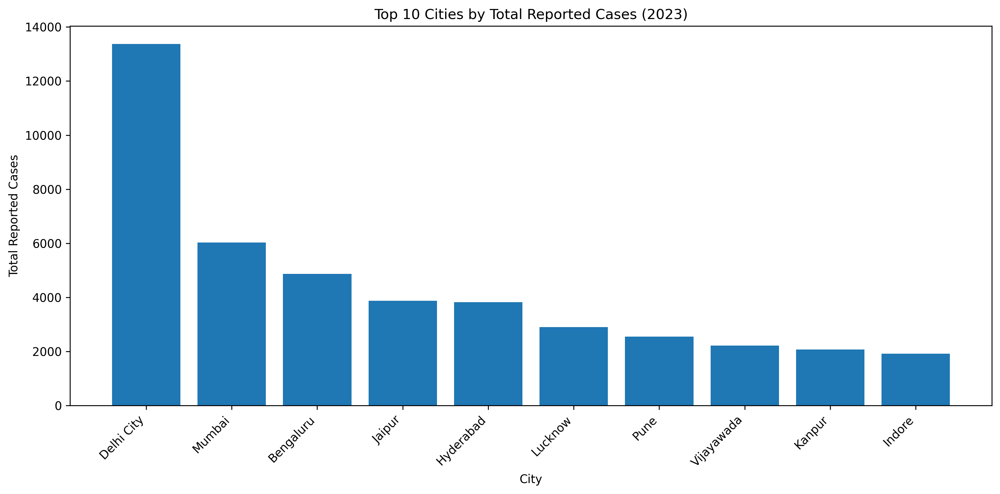
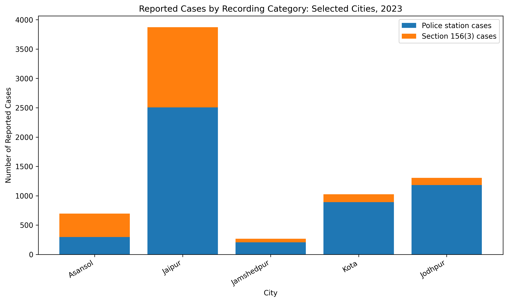

# Understanding Safety Challenges for Women in Indian Cities Through Data

## 1. Project Overview

Women's safety is an important social concern. Analysing officially reported data can help us understand patterns in recorded cases and identify questions that deserve further investigation.

This project explores city-level data on cases registered under crimes against women in Indian metropolitan cities during 2023. Using Python, pandas, and Matplotlib, the project examines total reported counts and the distribution between two reporting categories included in the dataset.

The project demonstrates an end-to-end beginner-level data analysis workflow, from loading and cleaning data to exploratory analysis, ranking, percentage calculations, visualisation, and documentation.

**Important:** Reported case counts do not directly measure women's safety or the actual prevalence of crime. This project describes patterns in the available dataset and does not rank cities by safety.

## 2. Project Objectives

- Load and inspect a real-world Excel dataset.
- Clean blank rows and prepare data for analysis.
- Check missing values and review descriptive statistics.
- Identify cities with the highest absolute reported counts.
- Calculate the share of cases recorded under Cr.P.C. Section 156(3).
- Compare reporting categories across selected cities.
- Create clear, reproducible data visualisations.
- Document findings, data limitations, and possible future improvements.

## 3. Tools and Technologies

| Tool | Purpose |
|---|---|
| Python | Data analysis and automation |
| pandas | Data cleaning, manipulation, sorting, and summary statistics |
| Matplotlib | Data visualisation |
| Microsoft Excel | Original dataset format |
| CSV | Storage of cleaned data and results |
| Visual Studio Code | Development environment |

## 4. Dataset and Source

The dataset was downloaded from OpenCity's *Crime in India – 2023* collection. The resource identifies the National Crime Records Bureau (NCRB) as the original data source.

### Dataset details

- **Dataset title:** City-wise Cases Registered 156_3 under Crimes against Women during 2023
- **Original data source:** National Crime Records Bureau (NCRB), Government of India
- **Data access platform:** OpenCity
- **Reporting year:** 2023
- **Original file format:** Excel (`.xlsx`)
- **Dataset resource:** [City-wise 2023 dataset](https://data.opencity.in/dataset/crime-in-india-2023/resource/24d8387c-73b4-4238-b8d0-93ef93b0c457)
- **Dataset collection:** [Crime in India – 2023](https://data.opencity.in/dataset/crime-in-india-2023)
- **Licence:** Refer to the resource page for the displayed licence and reuse conditions.

The dataset contains city-level counts for two reporting categories: cases under Cr.P.C. Section 156(3) and cases reported at police stations.

The analysis uses the figures provided in the downloaded resource. It does not independently verify the original administrative records.

## 5. Project Structure

```text
women-safety-india-data/
│
├── data/
│   ├── women_safety_city_data.xlsx
│   ├── women_safety_city_clean.csv
│   ├── top_10_cities.csv
│   ├── top_10_cities.png
│   └── reporting_categories_top5.png
│
├── Analysis.py
└── README.md
```

### File descriptions

| File | Description |
|---|---|
| `Analysis.py` | Python script for cleaning, analysis, and visualisation |
| `women_safety_city_data.xlsx` | Original downloaded Excel file |
| `women_safety_city_clean.csv` | Cleaned city-level dataset |
| `top_10_cities.csv` | Exported top-10 ranking |
| `top_10_cities.png` | Bar chart of the 10 highest-count cities |
| `reporting_categories_top5.png` | Stacked bar chart comparing reporting categories |
| `README.md` | Project documentation |

## 6. Research Questions

This exploratory analysis addresses the following questions:

1. Which cities have the highest absolute reported case counts in the dataset?
2. How does the distribution between the two reporting categories vary across cities?
3. Which cities have the highest percentage of cases recorded under Section 156(3)?
4. What can and cannot be inferred from these city-level counts?

The analysis is descriptive. It does not attempt to predict crime, identify individual incidents, or determine which city is safest.

## 7. Methodology

### Step 1: Data loading

The Excel workbook was imported into Python using pandas.

### Step 2: Data cleaning

The following preparation steps were performed:

- Removed the blank row from the imported spreadsheet.
- Removed rows without a city name.
- Standardised whitespace in city names.
- Converted case-count columns to numeric values.
- Reset the row index after removing unwanted rows.
- Saved the cleaned data as a CSV file.

After cleaning, the analysis contained **52 city records and four original data columns**.

### Step 3: Exploratory data analysis

Descriptive statistics were generated to examine the distribution of numerical columns, including the mean, median, minimum, maximum, and standard deviation.

### Step 4: City ranking

Cities were sorted in descending order by `Total_cases_reported`. The first 10 records were selected and exported as a separate CSV file.

### Step 5: Percentage calculation

The share of cases under Section 156(3) was calculated for each city:

**Section 156(3) share (%) = (Cases under Section 156(3) ÷ Total reported cases) × 100**

This percentage describes the composition of the reported categories in the dataset.

### Step 6: Data visualisation

Two visualisations were created using Matplotlib:

1. A bar chart of the 10 cities with the highest total reported counts.
2. A stacked bar chart comparing the two reporting categories for the five cities with the highest Section 156(3) shares.

## 8. Results and Findings

### 8.1 Top 10 cities by total reported cases

The following table presents the 10 highest absolute counts in the dataset for 2023.

| Rank | City | Total reported cases |
|---:|---|---:|
| 1 | Delhi City | 13,366 |
| 2 | Mumbai | 6,025 |
| 3 | Bengaluru | 4,870 |
| 4 | Jaipur | 3,872 |
| 5 | Hyderabad | 3,822 |
| 6 | Lucknow | 2,902 |
| 7 | Pune | 2,550 |
| 8 | Vijayawada | 2,221 |
| 9 | Kanpur | 2,071 |
| 10 | Indore | 1,919 |

**Finding:** Delhi City had the highest absolute reported count in the dataset, followed by Mumbai and Bengaluru.

These values are absolute counts. They have not been adjusted for population size or differences in reporting practices.

### 8.2 Section 156(3) share across selected cities

The following cities had the five highest calculated shares of Section 156(3) cases in the dataset.

| City | Section 156(3) cases | Total reported cases | Share |
|---|---:|---:|---:|
| Asansol | 400 | 695 | 57.55% |
| Jaipur | 1,367 | 3,872 | 35.30% |
| Jamshedpur | 60 | 266 | 22.56% |
| Kota | 134 | 1,026 | 13.06% |
| Jodhpur | 121 | 1,304 | 9.28% |

**Finding:** Asansol had the highest calculated Section 156(3) share among the five cities shown, at 57.55%. Jaipur had the largest absolute number of Section 156(3) cases among these five cities, with 1,367.

The two rankings answer different questions: one compares total counts, while the other compares the percentage composition of recorded categories.

These results describe the dataset's reporting categories; they do not establish the prevalence of violence or the level of safety in any city.

## 9. Visualisations

### Chart 1: Top 10 Cities by Total Reported Cases



This bar chart compares the absolute reported counts for the 10 highest-count cities in the dataset.

**Interpretation:** Delhi City has the tallest bar, indicating the highest absolute count among the cities shown. The chart does not account for population size or reporting differences.

### Chart 2: Reporting Categories in Selected Cities



This stacked bar chart compares cases under Section 156(3) with cases reported at police stations for the five cities with the highest calculated Section 156(3) shares.

**Interpretation:** The chart shows the distribution between the two categories in the downloaded data. It should not be interpreted as a measure of city safety.

## 10. Key Takeaways

- The dataset enables descriptive comparisons of reported case counts across 52 metropolitan city records.
- Delhi City had the highest absolute total in the analysed data.
- The calculated share of Section 156(3) cases varied considerably across cities.
- Absolute counts and category percentages provide different perspectives on the same dataset.
- Data cleaning, sorting, percentage calculations, and visualisation help make the data easier to explore.
- Crime-related data requires careful interpretation and transparent communication of limitations.

## 11. Limitations

### 11.1 Reported cases are not all incidents

The dataset represents recorded cases in the source. It cannot establish how many incidents occurred but were never reported or registered.

### 11.2 Absolute counts are not crime rates

Cities differ in population size. Without reliable and comparable population figures, absolute counts cannot be used to compare per-capita rates.

### 11.3 Single-year analysis

The analysis covers 2023 only. It cannot establish whether reported counts increased or decreased over time.

### 11.4 No neighbourhood-level information

The analysed dataset contains city-level records, not detailed neighbourhood locations. It does not support mapping specific neighbourhood hotspots.

### 11.5 No time-of-day information

The data does not contain the incident-level timestamps needed to examine when incidents occurred.

### 11.6 No detailed offence breakdown in the analysed columns

The four columns used in this project do not provide a breakdown by individual offence type.

### 11.7 Reporting categories require context

The source definitions and the relationship between the two reporting categories should be verified. The analysis does not assume that the categories explain every stage of reporting, investigation, or case processing.

### 11.8 Safety cannot be ranked from these figures alone

Higher reported counts do not automatically mean that a city is less safe. Lower counts do not automatically mean it is safer. Population, reporting behaviour, administrative practices, and other factors can affect the figures.

## 12. Future Improvements

Potential extensions include:

- Verifying and documenting the original source's definitions and metadata.
- Adding comparable data from other years to analyse changes over time.
- Obtaining reliable population figures to calculate suitable population-adjusted rates.
- Incorporating a separately documented dataset with detailed offence categories, if available.
- Exploring district-level data as a separate analysis.
- Building an interactive dashboard with Power BI or Tableau.
- Improving chart annotations, labels, and source notes.
- Adding automated checks for missing values, duplicates, and inconsistent totals.
- Comparing trends across cities when comparable multi-year data becomes available.

Each extension will depend on the availability, comparability, and quality of the relevant data.

## 13. Skills Demonstrated

This project demonstrates practice in:

- Reading Excel files with pandas.
- Cleaning missing and unnecessary rows.
- Converting columns to numeric data types.
- Generating descriptive statistics.
- Sorting and ranking records.
- Creating calculated columns and percentages.
- Producing bar charts and stacked bar charts with Matplotlib.
- Exporting cleaned data and analysis results to CSV.
- Documenting methodology, findings, and limitations.
- Communicating data insights responsibly.

## 14. Conclusion

This project demonstrates a beginner-level end-to-end data analysis workflow using a real-world city-level dataset on cases registered under crimes against women in 2023.

The work includes data loading, cleaning, exploratory analysis, city ranking, percentage calculations, visualisation, and documentation.

The findings describe patterns in the reported categories contained in the dataset. They do not provide a definitive assessment of women's safety in Indian cities. Further source verification and additional contextual data would be needed to support more comprehensive conclusions.

---

**Project status:** Initial exploratory data analysis completed. Verification of source definitions and further analysis remain outstanding.

**Author:** RoseInsights


